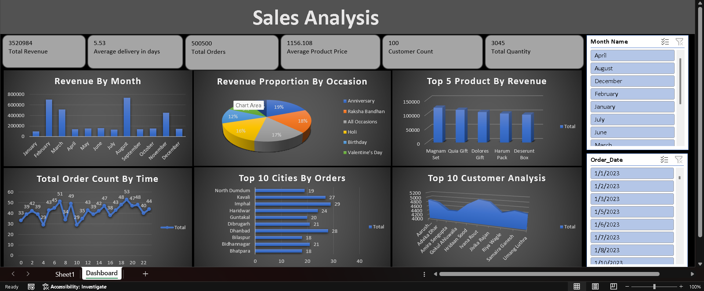

# 🌸 Ferns and Petals (FNP) - Sales Analysis Dashboard

## 📌 Project Overview
An interactive Excel dashboard analyzing sales performance, customer trends, product popularity, and delivery metrics for Ferns and Petals across various occasions in 2023.

---

## 📊 Dashboard Preview

---

## 🎯 Key Business Questions Solved
* Total Revenue & Average Order Value (AOV)
* Monthly sales fluctuation & seasonality
* Top 5 revenue-generating products
* Top 10 cities by order volume
* Occasion-wise revenue split & product popularity
* Delivery time vs. Order quantity relationship

---

## 🛠️ Tools & Techniques Used
* **Microsoft Excel:** Pivot Tables, Pivot Charts, Slicers, Timeline
* **Key Formulas:** XLOOKUP, INDEX/MATCH, SUMIFS, AVERAGEIFS
* **Data Cleaning & Interactive Dashboard Design**
